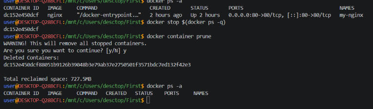

# Подготовка Docker (чтобы начать работать с "чистого листа")

1. Остановить все запущенные контейнеры

2. Удалить все остановленные контейнеры

3. Удалить все неиспользуемые образы

- Следует убедиться, нет ли у вас уже установленных и запущенных контейнеров:

```shell
docker ps -a
```

- Если есть, то лучше их остановить:

```shell
docker stop $(docker ps -q)
```

- Если остановленные контейнеры не нужно, то удалить их:

```shell
docker container prune
```

или

```shell
docker container prune $(docker ps -q)
```

- Ещё раз убедиться, что нет лишних контейнеров:

```shell
docker ps -a
```



- Опционально можно удалить ненужные образы. Показать текущие образы:

```shell
docker images
```

Удалить все ненужные образы

```shell
docker image prune -a
```

или

```shell
docker rmi $(docker images -q)
```

> Удалять нужно только учебные контейнеры и образы, т.к. есть риск потерять важные данные, которые могут содержаться в контейнерах!